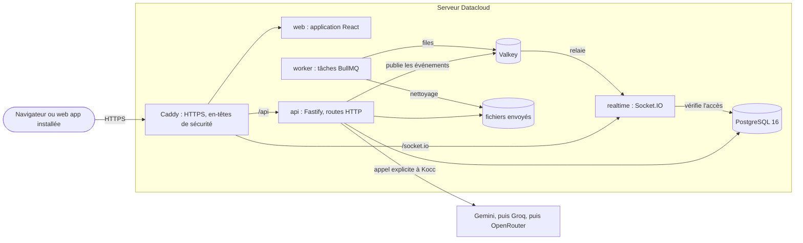

# Kemet

Kemet, c'est l'endroit où les développeurs africains échangent, s'entraident,
montrent leurs travaux et trouvent des opportunités. Kocc, l'assistant de la
plateforme, répond en s'appuyant sur les skills écrits par la communauté et
cite leur auteur.

Projet présenté à la CADEV 2026 (Systalink).

- **Démo :** https://kemetlabs.dev
- **Parcours de cinq minutes :** [`docs/GUIDE-JURY.md`](docs/GUIDE-JURY.md)
- **Hébergement :** un serveur Datacloud

## Architecture



`api` écrit, `realtime` diffuse, et les deux ne se parlent que par Valkey :
chacun redémarre sans l'autre. L'assistant s'appelle désormais Kocc
(`@kocc`, l'ancien `@kemet` reste reconnu) ; le code garde le nom interne
`kemet`. Il passe par une chaîne de fournisseurs sur leurs offres gratuites
et ne reçoit que ce qui est décrit dans
[`DECLARATION-IA.md`](DECLARATION-IA.md).

## Ce qu'on peut y faire

Des salons en temps réel (espaces publics ou sur invitation, fils, réactions,
fichiers, messages vocaux, Markdown et code coloré), une messagerie privée,
et un fil de posts avec trois formats facultatifs : Astuce, À tester,
Question. Appelé dans un salon ou sous un post, Kocc choisit le skill de la
communauté qui correspond à la question, répond en streaming et cite le
skill et son auteur.

Les Travaux montrent ce que chacun a construit (projets de classe, stages,
mémoires, applications), et "Qui a travaillé sur ce sujet ?" met en relation
avec les personnes qui ont déjà travaillé sur un sujet proche. On y trouve
aussi des projets qui cherchent de l'aide, des compétitions en équipe notées
par un jury et par le public, et cinq niveaux, d'Apprenti à Légende, gagnés
seulement par une aide reconnue par quelqu'un d'autre. Les administrateurs
traitent les signalements. Un visiteur lit le fil, les salons publics, les
skills et les travaux sans compte.

## Stack

Côté web : React, Vite, Tailwind, Radix UI et Lucide, en web app
installable. Côté serveur : Fastify pour l'API, Socket.IO pour le temps
réel, BullMQ pour les tâches. PostgreSQL 16 avec Drizzle, Valkey pour le
cache et la diffusion. Better Auth gère les comptes (Argon2id, GitHub,
Google, LinkedIn), le Vercel AI SDK et des appels HTTP directs les modèles,
la recherche plein texte de PostgreSQL le choix des skills. Docker Compose
et Caddy en production, Vitest et Playwright pour les tests.

Monorepo pnpm et Turborepo, TypeScript strict partout :

- `apps/web` : l'application web ;
- `apps/server` : trois processus, `api`, `realtime`, `worker` ;
- `packages/shared` : schémas Zod partagés entre client et serveur ;
- `packages/db` : schéma, migrations et données de démonstration ;
- `infra/` : Compose, Caddyfile, scripts de déploiement et de sauvegarde ;
- `evals/` : évaluations de l'assistant lancées à la main (injections,
  choix du skill, mise en relation) ;
- `docs/` : documents ci-dessous et décisions d'architecture (`docs/adr/`).

## Données de démonstration

Le site de démonstration est rempli par le script de seed
(`pnpm db:seed`, `packages/db/src/seed/`), idempotent, autorisé en
production :

- **Comptes de démonstration** : des profils fictifs, de
  plusieurs pays et niveaux, marqués `is_demo`, aux adresses en
  `@demo.kemetlabs.dev` qui ne reçoivent jamais d'email. Aucun n'est
  administrateur.
- **Contenus** : posts et réponses, espaces et salons, skills et leurs avis,
  travaux avec images et vidéos, projets, compétitions d'exemple,
  conversations privées. Les images et vidéos sont des pages HTML écrites à
  la main puis capturées ; aucune ne vient du web ni d'un générateur d'images.
- **Réponses de Kocc** : écrites à l'avance, marquées en base
  (`assistant_invocations.recorded`) et affichées "Réponse enregistrée".
- **Figurants** : environ 12 300 profils sans compte de connexion, qui
  donnent leur taille aux compteurs (abonnés, membres d'un espace). Ils ne
  sont jamais affichés ni joignables (`docs/adr/0032-figurants-invisibles.md`).
- **Mention sur le site** : "Données de démonstration" s'affiche quand
  `DEMO_CONTENT_NOTICE=true`.

Ce qui est réel : le code, l'hébergement, l'inscription et la connexion
(email, GitHub, Google, LinkedIn), le temps réel, les appels à Kocc faits
depuis un compte, et les comptes créés par de vraies personnes.

## Documents

| Document | Contenu |
| --- | --- |
| [`docs/GUIDE-JURY.md`](docs/GUIDE-JURY.md) | Un parcours de cinq minutes sur le site |
| [`docs/VISITE-DU-CODE.md`](docs/VISITE-DU-CODE.md) | Un message, un appel à Kocc et une mise en relation, fichier par fichier |
| [`docs/conception/`](docs/conception/index.md) | Cas d'utilisation, modèle de données, séquences, déploiement, en Mermaid |
| [`DECLARATION-IA.md`](DECLARATION-IA.md) | L'IA dans la construction et dans le produit |
| [`docs/EXPLOITATION.md`](docs/EXPLOITATION.md) | Coût, mémoire, reprise, sauvegardes, montée en charge |
| [`docs/PERFORMANCE.md`](docs/PERFORMANCE.md) | Mesures sur connexion lente et méthode pour les refaire |
| [`docs/DEPLOIEMENT.md`](docs/DEPLOIEMENT.md) | Toutes les commandes de déploiement et de restauration |
| [`docs/MODELE-ECONOMIQUE.md`](docs/MODELE-ECONOMIQUE.md) | Sources de revenus et hypothèses à vérifier |
| [`THIRD-PARTY.md`](THIRD-PARTY.md) | Dépendances directes, polices et icônes, avec leur licence |

## Lancer en local

Prérequis : Node.js 22, pnpm 9, Docker.

```
cp .env.example .env          # puis remplir les valeurs
pnpm install
docker compose -f infra/docker-compose.dev.yml --env-file .env up -d
pnpm db:migrate
pnpm db:seed
pnpm dev
```

L'application répond sur http://localhost:5173. PostgreSQL est publié sur le
port 5433, Mailpit (emails de vérification) sur http://localhost:8025.
L'assistant a besoin d'au moins une clé parmi `GOOGLE_GENERATIVE_AI_API_KEY`,
`GROQ_API_KEY` et `OPENROUTER_API_KEY`.

Pile complète, comme en production :

```
docker compose -f infra/docker-compose.yml --env-file .env up -d --build
```

Tests : `pnpm test`, `pnpm test:e2e`, `pnpm lint`, `pnpm typecheck`.

## Sécurité

Notes relevées sur kemetlabs.dev le 13 novembre 2026, toutes A+ :
[Mozilla HTTP Observatory](https://developer.mozilla.org/en-US/observatory/analyze?host=kemetlabs.dev) (115/100, 12 tests sur 12),
[Qualys SSL Labs](https://www.ssllabs.com/ssltest/analyze.html?d=kemetlabs.dev) et
[securityheaders.com](https://securityheaders.com/?q=kemetlabs.dev&followRedirects=on). Détail et limites sur la page `/securite`.

## Licences

Code : copyright (c) 2026 Cheikh Mbacke Cisse, tous droits réservés
(fichier `LICENSE`). Toutes les dépendances, directes et indirectes, sont
sous licence MIT, Apache 2.0, BSD, ISC ou PostgreSQL, plus OFL-1.1 pour les
polices et CC0 pour les logos Simple Icons. Aucune dépendance GPL, AGPL ou
LGPL : `pnpm licenses:check` échoue sinon, et la CI vérifie que
`THIRD_PARTY_LICENSES.md` est à jour. C'est ce qui a écarté sharp, ClamAV,
MinIO et Redis 8 (remplacé par Valkey). Les images Docker de base (Alpine)
contiennent des outils système sous GPL, comme BusyBox : c'est
l'environnement d'exécution, Kemet ne les intègre ni ne les modifie.

L'usage de l'IA est déclaré dans [DECLARATION-IA.md](DECLARATION-IA.md).

## Limites connues

- Pas de paiement réel : la page Kemet Pro présente l'offre, son bouton est
  désactivé.
- Pas de notifications, ni de présence ("membres en ligne") dans les salons.
- Messages privés stockés sur le serveur sans chiffrement de bout en bout,
  ce que dit la page de confidentialité.
- Pas d'antivirus sur les fichiers envoyés (ClamAV est GPL) : type détecté
  par le contenu, SVG jamais affiché en page, en-têtes stricts sur la route
  de service, quota par utilisateur.
- Kocc dépend des offres gratuites de Gemini, Groq et OpenRouter : débit
  limité, et un message clair s'affiche quand toute la chaîne est saturée.
- Recherche de skills en plein texte, sans recherche sémantique.
- Un seul serveur ; en 3G, le fil met une douzaine de secondes à s'afficher
  sans rendu côté serveur (`docs/PERFORMANCE.md`).
- Routeur : quand une page chargée à la demande redirige juste après une
  autre redirection, la seconde se perd. Contourné pour `/ton-role` ; toute
  nouvelle redirection doit viser sa destination finale.
