# Cas d'utilisation

Mermaid n'a pas de diagramme de cas d'utilisation : les acteurs sont à gauche,
les cas regroupés par module, et un trait relie un acteur à ce qu'il peut faire.
Un membre peut faire tout ce que fait un visiteur ; un administrateur et un
juré sont des membres avec un droit de plus.

```mermaid
flowchart LR
  visitor([Visiteur])
  member([Membre])
  admin([Administrateur])
  juror([Juré, niveau Architecte et plus])
  kocc([Assistant Kocc])

  subgraph Lecture
    readSpaces[Lire les espaces et salons publics]
    readFeed[Lire le fil Pour toi]
    readSkills[Lire les skills publics]
    readWorks[Lire les travaux et les profils]
    readAnswers[Lire les réponses enregistrées de Kocc]
    relatedPeople[Voir qui a travaillé sur un sujet proche, sans le modèle]
  end

  subgraph Compte
    signup[Créer un compte, email ou GitHub, Google, LinkedIn]
    profile[Compléter son profil, rôle, parcours, CV et liens]
    export[Exporter ses données]
    deleteAccount[Supprimer son compte]
  end

  subgraph Salons
    post[Écrire dans un salon, fichiers, réactions, fils]
    mention[Appeler Kocc dans un salon]
    createSpace[Créer un espace public ou privé, inviter]
  end

  subgraph Messagerie
    writeDm[Écrire à quelqu'un en privé]
    acceptDm[Accepter ou refuser une demande]
    block[Bloquer un profil]
    teamDm[Écrire à l'équipe d'un travail]
  end

  subgraph Contenus
    feedPost[Publier un post, Astuce, À tester, Question]
    react[Répondre, republier, aimer, enregistrer un post]
    askPost[Appeler Kocc dans une réponse de post]
    createSkill[Créer un skill]
    publishWork[Publier un travail avec ses coauteurs]
    whoWorked[Demander qui a travaillé sur ce sujet]
    project[Créer un projet, publier une demande d'aide, postuler]
  end

  subgraph Compétitions
    proposeComp[Proposer une compétition]
    join[S'inscrire en équipe et soumettre]
    vote[Voter]
    score[Noter une soumission]
  end

  subgraph Modération
    report[Signaler un contenu ou un profil]
    resolve[Traiter un signalement, masquer, suspendre]
    validateComp[Valider une compétition]
    verify[Vérifier un parcours]
  end

  visitor --- readSpaces & readFeed & readSkills & readWorks & readAnswers & relatedPeople & signup
  member --- profile & export & deleteAccount
  member --- post & mention & createSpace
  member --- writeDm & acceptDm & block & teamDm
  member --- feedPost & react & askPost & createSkill & publishWork & whoWorked & project
  member --- proposeComp & join & vote & report
  juror --- score
  admin --- resolve & validateComp & verify
  mention -.- kocc
  askPost -.- kocc
  whoWorked -.- kocc
```

Règles qui ne se voient pas sur le schéma :

- Un compte suspendu garde la lecture, perd l'écriture (`requireOwnProfile`
  dans chaque module d'écriture, voir `docs/adr/0016-moderation.md`).
- Kocc ne lit jamais une conversation privée : une mention n'y déclenche
  rien (`apps/server/src/api/routes/messages.ts`).
- Kocc ne répond qu'à un appel explicite (`@kocc`, ou l'ancien `@kemet`
  gardé comme alias). Un post seul ne l'appelle jamais : seule une réponse
  sous le post le fait (`docs/adr/0033-kemet-sous-les-posts.md`).
- Un visiteur ne déclenche aucun appel au modèle : il voit des réponses
  enregistrées et une mise en relation calculée par tags communs.
- Un administrateur ne vérifie jamais son propre parcours, et aucun compte de
  démonstration n'est administrateur.
