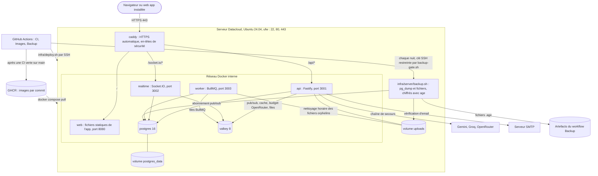

# Déploiement

Toute l'application tourne sur un seul serveur Datacloud, en
conteneurs Docker décrits par `infra/docker-compose.yml`. Seul Caddy est
exposé. Procédure complète : `docs/DEPLOIEMENT.md`. Décisions :
`docs/adr/0002-hebergement.md`, `docs/adr/0020-deploiement-production.md`.

Ce que le schéma montre :

- **Un seul point d'entrée.** Caddy obtient seul son certificat Let's Encrypt
  pour `PUBLIC_HOST` ; `api`, `realtime`, `worker`, `postgres` et `valkey`
  n'ont aucun port publié.
- **Le temps réel passe par Valkey.** `api` publie un événement, `realtime`
  le relaie aux rooms Socket.IO authentifiées. Les deux processus se
  redémarrent indépendamment.
- **Déploiement par commit.** `infra/deploy.sh` télécharge les images d'un
  commit publiées sur GHCR, attend que chaque service soit sain, joue le test
  de fumée `@prod-smoke` et revient au commit précédent en cas d'échec. Avec
  `KEMET_BUILD_ON_SERVER=1`, il construit les images sur le serveur à la
  place, pour un commit qui n'a pas d'image publiée ; les mêmes vérifications
  suivent.
- **Sauvegardes chiffrées avant de quitter le serveur.** La clé privée `age`
  ne va jamais sur le serveur ; une restauration est jouée pour de vrai par
  le job CI `backup-restore`.

En production depuis le 07/11/2026 sur `kemetlabs.dev` (Ubuntu 24.04,
4 Go de mémoire). Les limites de mémoire de chaque service sont fixées dans
`infra/docker-compose.yml` ; la mémoire mesurée est dans
`docs/EXPLOITATION.md`.
