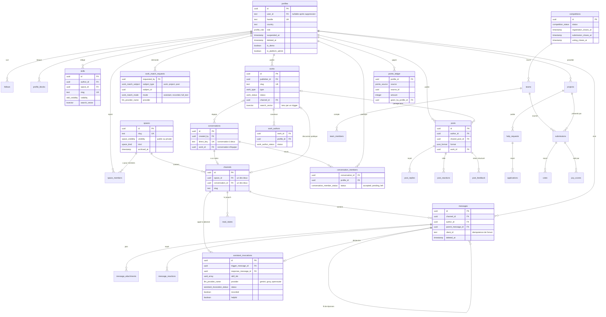

# Modèle de données

Tiré du schéma Drizzle (`packages/db/src/schema/`). Seules les tables
principales et leurs clés figurent ici ; les tables de Better Auth (`user`,
`session`, `account`, `verification`), `skill_files`, `skill_ratings`,
`mcp_servers`, `space_invites`, `message_mentions`, `post_attachments`,
`work_external_authors`, `work_links`, `work_attachments`, `credentials`,
`reports` et `moderation_actions` sont omises pour garder le schéma lisible.

Aucun total n'est stocké : points, niveau, phase d'une compétition, classement
et non-lus se calculent à la lecture.

Contraintes à connaître :

- `channels` : `CHECK` sur `space_id` ou `conversation_id`, jamais les deux
  (`docs/adr/0026-messagerie-privee.md`).
- `points_ledger` : index unique sur `(source, source_id, profile_id)`, qui
  rend chaque attribution idempotente (`docs/adr/0011-points-et-niveaux.md`).
- `reports` et `moderation_actions` visent un message, un post ou un profil
  sans clé étrangère (`target_type`, `target_id`) : une cible supprimée ne
  fait pas disparaître le journal de modération.
