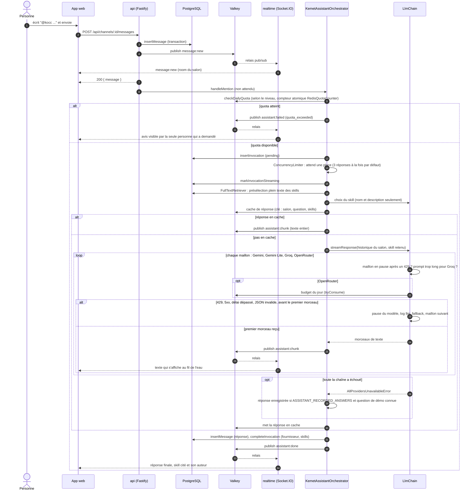

# Séquence : un appel à Kocc

Une personne écrit `@kocc` (ou l'ancien `@kemet`, gardé comme alias) dans
un salon d'espace. Le code garde le nom interne `kemet` (classes, tables). La route d'envoi répond
tout de suite avec le message enregistré ; la réponse de l'assistant arrive
ensuite morceau par morceau par Socket.IO. Code :
`apps/server/src/api/routes/messages.ts`,
`apps/server/src/ai/assistant-orchestrator.ts`,
`apps/server/src/ai/assistant-answerer.ts`, `apps/server/src/ai/llm-chain.ts`.
Un appel sous un post suit le même cœur (`AssistantAnswerer`) par
`KemetPostAssistant` (`apps/server/src/ai/post-assistant.ts`).

Points de conception :

- Le quota se vérifie avant de créer la ligne d'invocation, sinon elle
  compterait dans son propre total.
- Le contenu des skills et l'historique du salon sont passés comme données,
  jamais dans la consigne système (`docs/adr/0009-assistant-kemet.md`).
- Les pauses après un 429 vivent en mémoire du processus `api` ; seul le
  budget OpenRouter est partagé, dans Valkey
  (`docs/adr/0027-chaine-de-secours-ia.md`).
- Si un fournisseur échoue après le premier morceau, la réponse n'est pas
  recommencée ailleurs : l'invocation échoue et la personne voit l'erreur.
