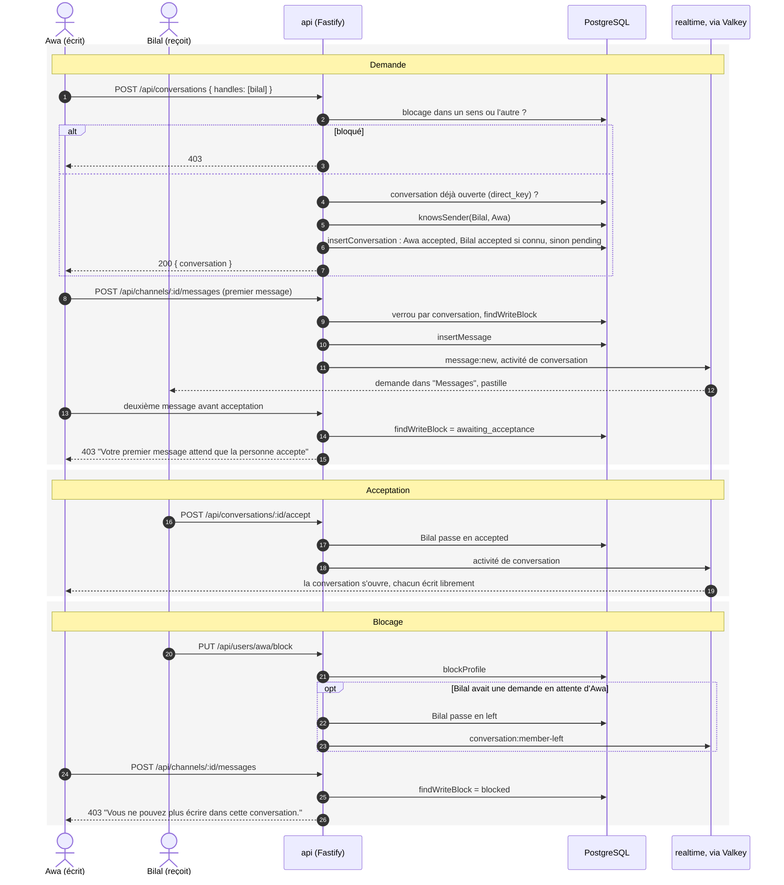

# Séquence : messagerie privée

Une conversation privée est un salon sans espace : elle réutilise les
messages, fichiers, réactions et non-lus des salons. Ce qui change, c'est qui
peut écrire. Code : `apps/server/src/api/routes/conversations.ts`,
`apps/server/src/messaging/write-block.ts`,
`apps/server/src/api/repositories/conversations.ts`. Décisions :
`docs/adr/0026-messagerie-privee.md`.

"Se connaître" (`knowsSender`) veut dire : la destinataire suit la personne
qui écrit, ou elles partagent un espace privé, ou elles ont signé un même
travail.

Variantes :

- **Groupe** (plusieurs destinataires) : pas de demande. Chaque destinataire
  doit déjà connaître la personne qui écrit, et aucun destinataire ne doit en
  avoir bloqué un autre, sinon refus. Sans cette règle, un complice qui
  accepte lèverait la limite d'un message pour tous.
- **Équipe d'un travail** (`POST /api/conversations/team`) : chaque auteur
  reçoit une demande, même s'il connaît la personne, et un blocage entre
  deux auteurs n'est jamais opposé à la personne qui écrit.
- Kocc n'est jamais appelé dans une conversation privée.
