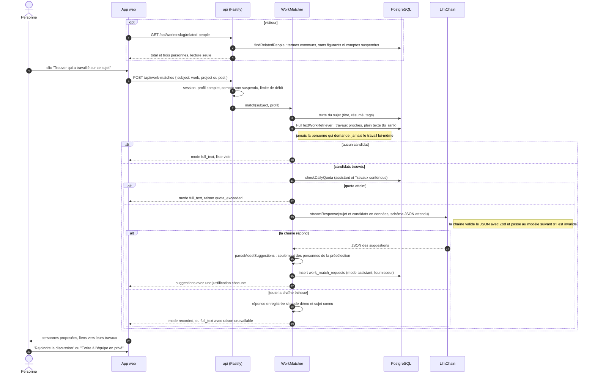

# Séquence : "Qui a travaillé sur ce sujet ?"

Sur un travail, un projet ou un post Question, un bouton demande à Kocc de
proposer des personnes qui ont publié un travail proche. L'appel n'est jamais
fait au chargement de la page, seulement au clic, et jamais pour un visiteur :
sur un travail ou un projet, un visiteur voit à la place jusqu'à trois
personnes trouvées par tags et stack communs, sans le modèle
(`GET /api/works/:slug/related-people`, `GET /api/projects/:slug/related-people`,
`apps/server/src/api/repositories/related-people.ts`). Code :
`apps/server/src/api/routes/work-matches.ts`,
`apps/server/src/ai/work-matcher.ts`, `apps/server/src/ai/work-retriever.ts`.
Décisions : `docs/adr/0025-travaux.md`.

Points de conception :

- Le résumé d'un travail est un texte écrit par n'importe qui : il est passé
  comme donnée, et une suggestion hors de la présélection est rejetée (cas
  testé dans `evals/prompt-injection.ts`).
- Le prompt est coupé au-delà d'environ 6 000 tokens estimés, la limite par
  minute de Groq.
- Quand aucun fournisseur ne répond, rien ne compte dans le quota du jour.
